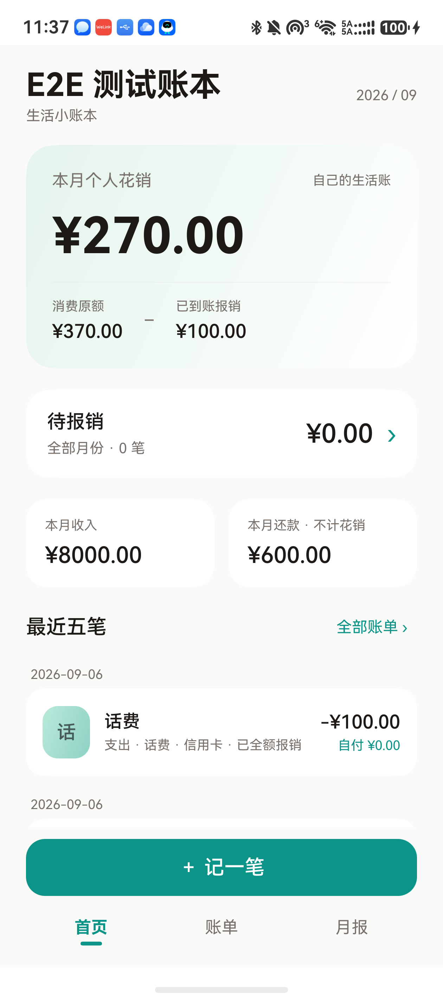
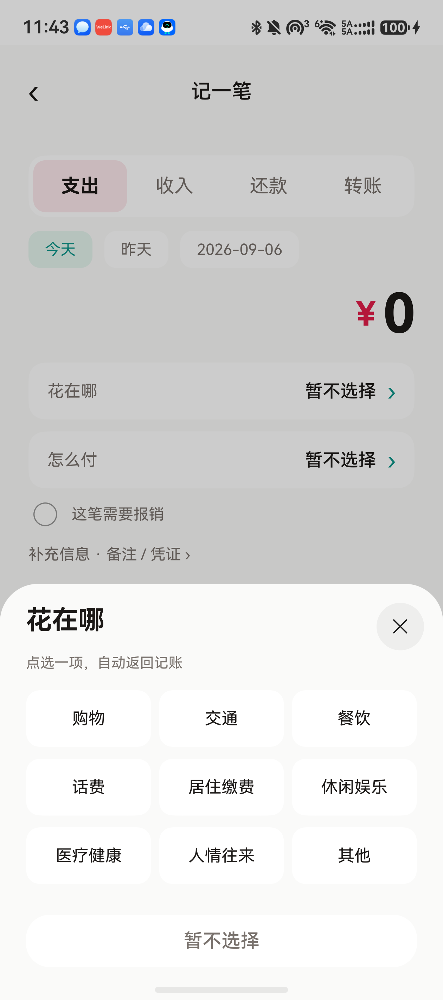
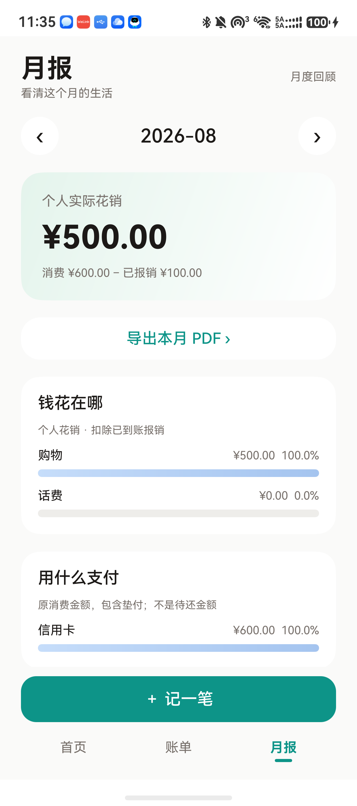

# Bill · 生活小账本

一个用 ArkTS / ArkUI 编写的 HarmonyOS 本地记账 App。把日常消费、信用消费还款和公司报销分开记录，看清真正由自己承担的花销。

## 适合怎样记账

- **消费时记支出**：零钱、信用卡、花呗等支付方式都在消费当天记账。
- **还钱时记还款**：平台欠款统一记录，不必细分是哪张信用卡，也不重复计入花销。
- **公司报销回到原消费**：话费默认待报销。收到钱后确认全额或填写累计到账金额，冲减原消费月份的个人花销，不计为新收入。

例如：8 月信用卡购物 500 元、充值话费 100 元；9 月公司报销话费 100 元并偿还信用卡 600 元。8 月个人花销最终为 **500 元**，9 月不会因为还款再增加 600 元消费。

> 本月个人花销 = 本月消费原额 − 这些消费累计已到账的报销。历史月份会随报销到账更新。

## 功能

| 页面 | 内容 |
| --- | --- |
| 首页 | 本月个人花销、消费与报销拆分、全部月份待报销、收入与还款、最近五笔 |
| 账单 | 默认全部时间；类型与跨月待报销筛选；编辑、删除确认；导出全部 CSV |
| 月报 | 月份切换、消费分类、支付分布、每日趋势、还款与报销汇总；PDF 预览及导出 |
| 记一笔 | 支出、收入、还款、转账；分类与支付方式底部点选；可选备注及图片凭证 |

**消费分类**：购物、交通、餐饮、话费、居住缴费、休闲娱乐、医疗健康、人情往来、其他。

**支付方式**：零钱、信用卡、花呗、白条、美团月付、抖音月付。分类和支付方式均可不选，新记录不沿用上一笔。

浅色账页、固定浅色渐变图表，支持系统深色模式。无记账提醒，无需账户或云端服务。

## 应用截图

以下均来自独立测试账本，金额与记录是测试数据。

<p align="center">
  
  
  
</p>

## 本地运行

1. 安装 DevEco Studio 和工程要求的 HarmonyOS SDK。工程目前配置 `compileSdkVersion: 26.0.0`、`compatibleSdkVersion: 6.1.0(23)`。
2. 用 DevEco Studio 打开仓库根目录，完成依赖同步。
3. 在 **Project Structure → Signing Configs** 配置自己的开发者签名，选择真机或已配置系统镜像的模拟器运行。

公开仓库的 `build-profile.json5` 不含签名信息。DevEco 写入签名后，该文件可能包含证书路径和密码，**不要提交本地签名改动**；Git 忽略规则不能保护已跟踪的文件。

覆盖现有 App 时，应使用相同包名、兼容签名及保留数据的安装方式。不要先卸载旧 App。使用独立测试账本验证写入操作，避免混入自己的正式记录。

## 数据与统计口径

- 数据保存在应用沙箱 `bill.db`，图片凭证保存在本地文件中。
- 支出、收入、还款和转账分别记录；还款与账户间转账不计个人消费。
- 报销保存累计到账金额，可处理部分到账、全额到账、结束和更正。
- **消费分类图表按个人花销统计；支付方式图表按原消费金额统计**，后者包含垫付，不代表当前待还款金额。
- CSV 是全部明细，PDF 是所选月份的可视化报表。导出文件可能包含你的备注、金额等个人数据，请自行保管。
- 当前没有 CSV 导入恢复或云同步；CSV/PDF 导出不等同于可完整恢复图片和数据库的备份。卸载 App 会影响本地数据。

## 开发与验证

技术栈：ArkTS、ArkUI 声明式 UI、Stage 模型、ArkData relationalStore、ArkWeb PDF、Hvigor。

```text
entry/src/main/ets/
├── common/          # BillStore、MonthlyReport、账单分组、主题、旧提醒清理
├── components/      # 账单行
├── entryability/    # 应用入口
└── pages/           # 启动页、三标签首页、记账、报销、PDF 预览
```

业务测试使用 Node.js 24+ 的 SQLite 功能与 DevEco SDK 内的 TypeScript 转译器：

```bash
node tests/reimbursement.cjs
node tests/monthly-report.cjs
node tests/reminder-retirement.cjs
```

默认转译器路径按 macOS 的 `/Applications/DevEco-Studio.app` 配置；其他安装位置可设置 `BILL_TYPESCRIPT_PATH`，指向 SDK 内的 `typescript/lib/typescript.js`。

已验证账务计算、旧数据兼容、跨月报销、还款去重、界面编辑与刷新、系统导出、键盘避让、深色模式和大字号。小尺寸使用真机内容区域约束模拟；手机导出文件未逐字节回读核验。详见 [内页改造与测试报告](docs/interior-redesign.md)。

### 从含提醒的旧版升级

最终版本不含提醒权限，也不发布提醒。启动清理失败时保留重试状态，不阻塞账本。

部分实机在移除权限后连取消旧提醒也返回 201。此类设备需要先通过保留原权限、只执行取消操作的过渡版本完成清理，再升级无提醒权限版本。本次验证设备已完成清理并在重启后确认提醒为零；不能据此保证其他旧设备直接升级也能成功清理。参见 [兼容处理说明](docs/interior-redesign.md#旧提醒清理的实机兼容处理)。

## 许可

仓库公开可浏览，目前未指定开源许可证。
